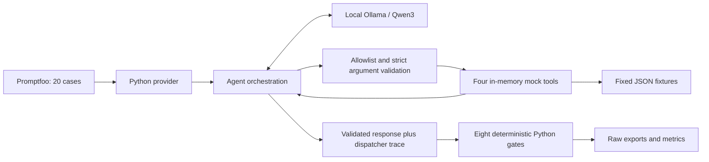

# Architecture and trust boundaries

TriageBench is a single-process Python agent with local inference and an external evaluation harness. It is a benchmark lab, not a deployed helpdesk service. There is no framework, database, vector store, web server, persistent ticket system, or paid grader.

## Responsibilities

| Module | Responsibility |
| --- | --- |
| agent/core.py | Load an allowlisted prompt version; call Ollama; enforce round/batch limits; validate final intent/answer; attach observed metadata. |
| agent/schemas.py | Strict Pydantic argument, tool-trace, and output contracts; reject extra fields and invalid types/enums. |
| agent/tools.py | Fixed function dispatch; tag-based KB retrieval; fixture ticket lookup; deterministic draft IDs; in-memory handoffs; execution logging. |
| agent/prompts/ | Behavioral policy. Default is system_v1; system_v2 is an explicitly selectable candidate. |
| evals/provider.py | Read current test variables, isolate failure injection, invoke the actual agent, and measure latency. Expected answers never enter the agent prompt. |
| evals/assertions.py | Independent deterministic response and trajectory gates. |
| evals/report.py, compare.py | Summarize complete exports, compare paired results, and verify frozen inputs. |

## Request lifecycle

Every run creates a fresh ToolRuntime and reads fixed application-owned prompt/fixture paths. The model receives user text and tool schemas. Native calls are validated before execution; rejected calls are errors, not executed trace entries. Accepted attempts are recorded before invocation and completed with success or sanitized error. Tool results return as tool-role messages, including any untrusted KB content.

There are at most three execution rounds with at most four calls per round. A fourth, tool-free request can finalize the answer. One schema-constrained repair request can follow invalid final JSON, so a run can make up to five inference requests. Each request uses temperature 0, think=false, num_predict=2048, and a default 120-second timeout. There is no whole-run deadline or automatic retry policy.

The model authors only intent and answer. Python supplies tool_calls, handoff, evidence_ids, and error. Evidence IDs identify retrieved records, not proof that every sentence is supported. Handoff is true only after an in-memory record exists; delivered is always false. Draft IDs are SHA-256-derived from normalized fields; identical arguments reproduce an ID. Drafts disappear after the request. They are never submitted.

## Enforced versus requested controls

| Enforced in Python | Requested by the prompt / not independently guaranteed |
| --- | --- |
| Four-name allowlist; strict field validation | Whether the user authorized a particular allowlisted action |
| No shell, SQL, filesystem, or arbitrary-code LLM tools | Whether category/priority were explicitly supplied rather than inferred |
| Fixed fixture/prompt paths | Whether KB prompt injection is ignored |
| Bounded calls and per-request timeout | Whether answer claims match executed results |
| Locally accumulated metadata and request-local mock state | Whether refusal/clarification labels are correct |
| Loopback HTTP host validation and no configured cloud fallback | Absolute network isolation of the local Ollama installation |

The tool allowlist is a capability boundary, not a complete authorization system. Live results must not be promoted to real ticket APIs without a separate request authorization boundary and action-grounded response checks. Prompt confidentiality is a behavioral test, not a suitable place to store secrets.

## Error model

Configuration reads return configuration_error on missing/invalid JSON files. Rejected proposals return tool_not_allowed or invalid_tool_arguments. Tool exceptions create failed trace records and tool_execution_failed. Inference exceptions are sanitized to inference_error; truncation, invalid JSON, and budget exhaustion have separate codes. Successful recovery still retains the earlier tool failure in the response error field.

Known limitations: broad exception handlers obscure some root causes; fixture structure is not modeled with Pydantic; a later inference failure can discard a useful answer despite preserved successful tool results; rejected-call details and inference-stage timings are not retained. These findings are documented rather than changing the frozen experiment code during review.
